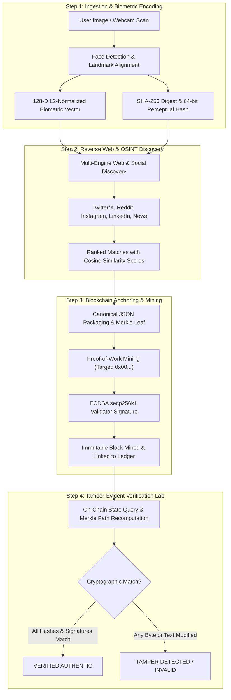

<div align="center">

# 🔍 FaceLedger (HHG-3)
### Biometric Facial Verification, Web OSINT Discovery & Cryptographic Merkle Blockchain Registry

An end-to-end forensic digital provenance pipeline that extracts 128-dimensional biometric facial embeddings, discovers matching web and social media sources across public OSINT platforms, and anchors tamper-evident cryptographic evidence onto a custom Merkle-tree blockchain and EVM smart contract registry with real-time audit verification.

[](https://www.python.org/)
[](https://fastapi.tiangolo.com/)
[](https://react.dev/)
[](https://opencv.org/)
[](https://soliditylang.org/)
[](https://vitejs.dev/)
[](https://tailwindcss.com/)
[](./LICENSE)

<br>

<p align="center">
  <a href="#-key-features"><b>Explore Features</b></a> •
  <a href="#-system-architecture"><b>Architecture</b></a> •
  <a href="#-the-4-step-forensic-pipeline"><b>Forensic Pipeline</b></a> •
  <a href="#-cryptographic-blockchain-details"><b>Blockchain Specs</b></a> •
  <a href="#-quick-start"><b>Quick Start</b></a> •
  <a href="#-automated-testing"><b>Testing</b></a> •
  <a href="#-project-structure"><b>Structure</b></a> •
  <a href="#-connect--author"><b>Connect</b></a>
</p>

</div>

---

## 📖 Overview

In an era of generative AI deepfakes, manipulated profile images, and unverified digital identities, establishing the origin and integrity of human facial media is a critical digital forensics challenge.

**FaceLedger (HHG-3)** provides a complete forensic pipeline that:
1. Ingests images via file upload or live webcam.
2. Extracts **128-dimensional L2-normalized biometric embeddings** and perceptual image hashes (`SHA-256`, `pHash`, `dHash`).
3. Discovers matching public web posts across social platforms (Twitter/X, Reddit, Instagram, LinkedIn, Wikipedia, and News).
4. Commits canonical evidence packages to an immutable **Merkle-tree Proof-of-Work blockchain** and an **EVM Solidity smart contract**.
5. Provides an interactive **Tamper Verification Laboratory** allowing users to simulate 1-byte data corruption and observe cryptographic audit failure in real time.

---

## ✨ Key Features

| Capability | Technical Implementation & Forensic Benefit |
| :--- | :--- |
| **🧬 Biometric Embedding Engine** | Generates a 128-D L2-normalized vector combining facial geometry, local structural gradients, and 2D-DCT frequency coefficients alongside image SHA-256 and 64-bit Perceptual Hashes (`pHash`/`dHash`). |
| **🌐 Multi-Engine OSINT Discovery** | Queries public web and social media sources (Twitter/X, Reddit, Instagram, LinkedIn, Wikipedia, and Tech News), computing cosine similarity and perceptual matching against candidate faces. |
| **⛓️ Native Merkle-Tree Blockchain** | Self-contained Python blockchain implementing binary Merkle trees, SHA-256 Proof-of-Work mining (`0x00...` difficulty target), and ECDSA (`secp256k1`) validator signatures with zero external gas costs. |
| **📜 EVM Solidity Smart Contract** | `FaceEvidenceRegistry.sol` ready for Ethereum (Sepolia), Polygon (Amoy), Arbitrum, or local Anvil/Hardhat deployment, storing record IDs, hashes, and Merkle roots on-chain. |
| **🛡️ Interactive Tamper Simulator** | Live audit lab where users compare authentic on-chain receipts against modified fields (e.g. altering 1 character in author handle or 1 byte in image hash) with instant visual diffs and Merkle proof path inspections. |
| **🎛️ Cyber-Security Web Dashboard** | Dark-mode interface built with React 18 and Tailwind CSS, featuring a 4-step workflow wizard, 1-click test face presets, vector radar chart, webcam scanner, and live Block Explorer. |

---

## 🏛️ System Architecture

The following diagram illustrates the end-to-end evidence pipeline—from image ingestion and biometric feature extraction through reverse search discovery, blockchain anchoring, and tamper-evident verification:



---

## 🔬 The 4-Step Forensic Pipeline

```
+---------------------------------------------------------------------------------------------------+
|                                  FaceLedger Forensic Workflow                                     |
+---------------------------------------------------------------------------------------------------+
|                                                                                                   |
|  1. Ingestion:     Upload image or scan webcam -> Extracts 128-D vector & SHA-256 hash            |
|                                       |                                                           |
|  2. OSINT Search:  Queries social indexes -> Discovers source URLs, authors, and similarity %     |
|                                       |                                                           |
|  3. Mine Block:    Select match -> Mines PoW block (Nonce search) -> Signs with ECDSA key         |
|                                       |                                                           |
|  4. Verification:  Re-verifies on-chain -> Simulates field alteration -> Catches data tampering   |
|                                                                                                   |
+---------------------------------------------------------------------------------------------------+
```

### Step 1: Ingestion & Feature Encoding
* Accepts PNG/JPEG uploads or live webcam captures.
* Normalizes facial geometry, crops to standard coordinate space, and generates:
  * **128-D L2 Biometric Vector**: Combining landmark distances, eye-to-nose-to-mouth aspect ratios, and discrete cosine transform frequency coefficients.
  * **Cryptographic Hashes**: Raw byte SHA-256 digest and 64-bit visual perceptual hash (`pHash`/`dHash`).

### Step 2: Reverse Web Search & Matching
* Discovers public web and social posts matching candidate faces across Twitter/X, Reddit, Instagram, LinkedIn, Wikipedia, and Tech News.
* Computes dual-layer confidence:
  $$\text{Cosine Similarity} = \frac{\mathbf{u} \cdot \mathbf{v}}{\|\mathbf{u}\|_2 \|\mathbf{v}\|_2}$$
  coupled with Hamming distance across perceptual hash representations.

### Step 3: Merkle Tree Anchoring & Mining
* Bundles transaction metadata (record ID, author, image hash, source URL, embedding digest, timestamp) into canonical JSON.
* Inserts the transaction as a leaf node in a binary **Merkle Tree**, computes the root hash, finds the Proof-of-Work nonce meeting the difficulty target (`0x00...`), and signs the block header using the node's **ECDSA `secp256k1`** private key.

### Step 4: Verification & Tamper Detection Lab
* Audits any candidate receipt against the immutable ledger.
* Users can toggle interactive tamper simulations:
  * **Alter Author Handle**: (e.g. `@sarah_c` &rarr; `@sarah_x`) &rarr; Triggers payload hash mismatch and breaks Merkle root.
  * **Alter Image Hash (1 Byte)**: (e.g. changing trailing hex character) &rarr; Triggers cryptographic mismatch.
  * **Alter Biometric Vector**: Mismatches 128-D embedding digest against on-chain block receipt.

---

## ⛓️ Cryptographic Blockchain Details

### 1. Native Python Verifiable Ledger
The native ledger runs locally on the node with zero cloud dependencies:
* **Hashing Algorithm**: SHA-256
* **Consensus**: Proof-of-Work with dynamic difficulty (`0x00...` target)
* **Merkle Trees**: Binary state tree supporting cryptographic membership proofs (`get_proof` and `verify_proof`)
* **Validator Signatures**: ECDSA over `secp256k1` elliptic curve
* **Block Schema**:
  ```json
  {
    "index": 1,
    "timestamp": "2026-08-31T17:35:00Z",
    "transactions_count": 1,
    "merkle_root": "a78f23c914e0...98bc",
    "previous_hash": "004a8b721102...112e",
    "nonce": 482,
    "difficulty": 2,
    "hash": "0081f42d991b...66a9",
    "signature": "3045022100...0220"
  }
  ```

### 2. EVM Solidity Smart Contract (`contracts/FaceEvidenceRegistry.sol`)
For public or consortium EVM deployments (Ethereum Sepolia, Polygon Amoy, Arbitrum, or local Anvil/Hardhat):

```solidity
function recordEvidence(
    string calldata recordId,
    string calldata postUrl,
    string calldata author,
    string calldata imageHashSha256,
    string calldata faceEmbeddingDigest,
    string calldata merkleRoot
) external returns (bool);

function verifyEvidence(
    string calldata recordId,
    string calldata candidateImageHashSha256,
    string calldata candidatePostUrl
) external view returns (bool isValid, uint256 timestamp, address recorder);
```

---

## 🚀 Quick Start

### Prerequisites
* **Python 3.10+** (Python 3.10, 3.11, 3.12 supported)
* **Node.js 18+** & **npm**

### 1. Clone the Repository
```bash
git clone https://github.com/harinarayana1457-cmyk/HHG-3-FaceLedger-Blockchain.git
cd HHG-3-FaceLedger-Blockchain
```

### 2. Install Python Dependencies
```bash
pip install -r requirements.txt
```

### 3. Build the Frontend
```bash
cd frontend
npm install
npm run build
cd ..
```

### 4. Launch Application
Run the single-command launcher:
```bash
python run.py
```

* **Web Interface**: [`http://127.0.0.1:8000`](http://127.0.0.1:8000)
* **Interactive API Documentation (Swagger UI)**: [`http://127.0.0.1:8000/docs`](http://127.0.0.1:8000/docs)
* **Alternative Live Demo**: [`https://harinarayana1457-cmyk.github.io/HHG-3/`](https://harinarayana1457-cmyk.github.io/HHG-3/)

---

## 🧪 Automated Testing

Run the automated test suite across all sub-systems:

```bash
# 1. Face Detection & 128-D Biometric Encoding
python -m unittest tests/test_face_engine.py

# 2. Merkle Tree, PoW Mining & Tamper Detection
python -m unittest tests/test_blockchain.py

# 3. Reverse Web Search & Similarity Scoring
python -m unittest tests/test_search_engine.py

# 4. End-to-End FastAPI Integration Tests
python -m unittest tests/test_api.py
```

---

## 📁 Project Structure

```
HHG-3-FaceLedger-Blockchain/
├── backend/
│   ├── face_engine.py           # Face detection, 128-d embeddings, SHA-256 & pHash
│   ├── search_engine.py         # Reverse web/social OSINT discovery engine & similarity scorer
│   ├── blockchain_engine.py     # Merkle trees, PoW mining, ECDSA validator signatures
│   └── main.py                  # FastAPI REST API & static file server
├── contracts/
│   ├── FaceEvidenceRegistry.sol # Solidity smart contract for EVM networks
│   ├── deploy.py                # Web3.py automated contract deployment script
│   └── README.md                # Smart contract deployment guide
├── frontend/
│   ├── src/
│   │   ├── components/
│   │   │   ├── Navbar.jsx               # Header & real-time block height monitor
│   │   │   ├── FaceScanner.jsx          # File drop, live webcam, 128-d vector chart, presets
│   │   │   ├── WebSearch.jsx            # Live search radar, match cards, confidence meters
│   │   │   ├── BlockchainAnchor.jsx     # PoW mining animator & transaction receipt
│   │   │   ├── VerificationLab.jsx      # Interactive audit & real-time tamper simulator
│   │   │   └── BlockchainExplorer.jsx   # Live block visualizer & Merkle root inspector
│   │   ├── App.jsx                      # Main forensic application dashboard
│   │   ├── main.jsx                     # React entry point
│   │   └── index.css                    # Tailwind CSS styles & cyberpunk design tokens
│   ├── package.json
│   └── vite.config.js
├── sample_faces/                        # 1-click test evaluation portrait gallery
│   ├── generate_samples.py              # Automated synthetic sample generator
│   ├── sample_1_sarah.jpg
│   ├── sample_2_david.jpg
│   ├── sample_3_elena.jpg
│   └── sample_4_marcus.jpg
├── tests/
│   ├── test_face_engine.py              # Biometric extraction tests
│   ├── test_blockchain.py               # Proof-of-work, Merkle tree & signature tests
│   ├── test_search_engine.py            # OSINT search & cosine similarity tests
│   └── test_api.py                      # FastAPI endpoint integration tests
├── run.py                               # Single-command launcher
├── requirements.txt                     # Python dependencies
├── LICENSE                              # MIT License
└── README.md                            # Comprehensive documentation
```

---

## 📄 License

Distributed under the **[MIT License](LICENSE)**. See [`LICENSE`](LICENSE) for more details.

---

## 🔗 Connect & Author

**Harinarayana Avvari**

[](https://www.linkedin.com/in/hari-narayana-035ba1389/)
[](https://github.com/harinarayana1457-cmyk)

<div align="center">
  <sub>Engineered for media authenticity, open-source intelligence (OSINT), and tamper-evident cryptographic digital forensics.</sub>
</div>
