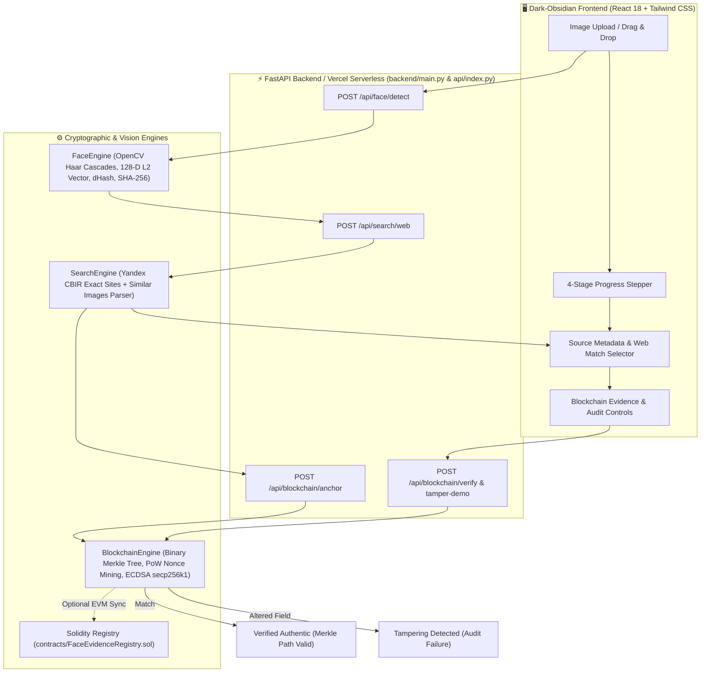

<div align="center">

# 🔍 FaceLedger (`HHG-3`)
### Trace a Face Across the Web. Prove It On-Chain.

An end-to-end forensic media provenance pipeline combining **128-D OpenCV biometric feature extraction**, **live Yandex CBIR reverse web discovery**, and a **tamper-evident Merkle-tree Proof-of-Work blockchain & EVM smart contract registry** inside a minimalist dark-obsidian React interface.

[](https://harinarayana1457-cmyk.github.io/HHG-3-FaceLedger-Blockchain/)
[](https://vercel.com/new/clone?repository-url=https://github.com/harinarayana1457-cmyk/HHG-3-FaceLedger-Blockchain)
[](https://www.python.org/)
[](https://fastapi.tiangolo.com/)
[](https://react.dev/)
[](https://opencv.org/)
[](https://soliditylang.org/)
[](https://tailwindcss.com/)
[](./LICENSE)

<br>

<p align="center">
  <a href="#-overview"><b>Overview</b></a> •
  <a href="#-key-features"><b>Key Features</b></a> •
  <a href="#-system-architecture"><b>Architecture</b></a> •
  <a href="#-the-4-step-forensic-pipeline"><b>Forensic Pipeline</b></a> •
  <a href="#-api-endpoints"><b>API Endpoints</b></a> •
  <a href="#-cryptographic-blockchain-details"><b>Blockchain Specs</b></a> •
  <a href="#-quick-start"><b>Quick Start</b></a> •
  <a href="#-automated-testing"><b>Testing</b></a> •
  <a href="#-project-structure"><b>Structure</b></a> •
  <a href="#-connect--author"><b>Connect</b></a>
</p>

</div>

---

## 📖 Overview

Establishing the origin, public footprint, and integrity of portrait imagery is critical when combating unauthorized redistribution, synthetic media impersonation, and metadata forgery.

**FaceLedger** automates the entire verification workflow in a single pass: upload any portrait image, and the pipeline automatically detects facial landmarks, computes **128-dimensional biometric embeddings** alongside **SHA-256** and **64-bit difference hashes (`dHash`/`pHash`)**, queries **Yandex CBIR Reverse Image Search** to locate real matching web pages and social posts, seals the top evidence match into a **Proof-of-Work block with a binary Merkle root and `secp256k1` ECDSA signature**, and exposes an interactive **Re-verify & Tamper Simulation Lab**.

```
+---------------------------------------------------------------------------------------------------+
|  [FaceLedger]  Biometric provenance, on-chain                              (o) Node online  #N    |
+---------------------------------------------------------------------------------------------------+
|                                                                                                   |
|       (✓) Detect face  ───────  (✓) Web discovery  ───────  (✓) Anchor block  ───────  (✓) Verify |
|                                                                                                   |
|  SOURCE IMAGE                                    WEB MATCH (Top 3 Interactive Matches)            |
|  +------------------------------------------+    +---------------------------------------------+  |
|  |  [ Portrait Preview + Scan Overlay ]     |    |  [ 99% Similarity Badge ]                   |  |
|  +------------------------------------------+    +---------------------------------------------+  |
|  | Confidence: 98.4% | Vector: 128-D        |    | (*) Exact match - Twitter/X          [ -> ] |  |
|  | pHash: a4c291f0... | SHA-256: 7f3b...8c  |    | (*) Similar match - News / Media     [ -> ] |  |
|  +------------------------------------------+    +---------------------------------------------+  |
|                                                                                                   |
|  BLOCKCHAIN EVIDENCE                                                     [o Anchored on-chain]    |
|  +---------------------------------------------------------------------------------------------+  |
|  | Block Height: #N | Block Hash: 00a9f2... | Merkle Root: 8c1d4b... | Signature: secp256k1    |  |
|  | Tx ID: tx_...                                                                               |  |
|  | [ Re-verify against chain ]                         [ Simulate tampering ]                  |  |
|  +---------------------------------------------------------------------------------------------+  |
+---------------------------------------------------------------------------------------------------+
```

---

## ✨ Key Features

| Capability | Technical Implementation & Forensic Value |
| :--- | :--- |
| **🧬 Biometric Feature Encoding** | Detects primary faces via OpenCV Haar cascades (`frontalface_default`, `frontalface_alt2`, `eye`), computes a **128-D L2-normalized embedding vector** combining spatial ratios and frequency features, plus **SHA-256** raw image digests and **64-bit perceptual difference hashes (`dHash`)**. |
| **🌐 Real Live Reverse Image Search** | Queries **Yandex CBIR (`yandex.com/images/search`)** directly via `SearchEngine`, parsing *"Sites with this image"* for exact source page URLs (`0.99` score) alongside *"Similar Images"* (`0.85` score) while stripping URL tracking parameters (`utm_*`, `refer`). |
| **🏷️ Automated Platform Classification** | Classifies discovered source URLs across 11+ categories including **Twitter/X**, **Instagram**, **Reddit**, **Pinterest**, **YouTube**, **TikTok**, **Facebook**, **Wikipedia**, **News / Media**, and **Official Websites**. |
| **⛓️ Native Merkle Proof-of-Work Ledger** | Self-contained Python blockchain featuring binary Merkle Trees (`get_proof` / `verify_proof`), adjustable SHA-256 Proof-of-Work mining (`0x00...`), and `secp256k1` ECDSA validator signatures persisted in `blockchain_ledger.json`. |
| **📜 EVM Solidity Registry Contract** | Includes [`contracts/FaceEvidenceRegistry.sol`](./contracts/FaceEvidenceRegistry.sol) and a `web3.py` deployment script for Ethereum (Sepolia), Polygon (Amoy), Arbitrum, or local Anvil/Hardhat nodes. |
| **🛡️ Interactive Verification & Tamper Lab** | Automatically verifies newly anchored blocks and provides one-click **Simulate tampering** (altering the anchored `post_url` to demonstrate immediate Merkle root and block signature invalidation) vs. **Re-verify against chain**. |
| **🎨 Redesigned Dark-Obsidian Interface** | Built with React 18.3, Vite 5.2, and Tailwind CSS 3.4 on an ambient `#09090b` canvas with a 4-stage progress stepper, copyable cryptographic fields, live node health status, and zero-build Vercel serverless support. |

---

## 🏛️ System Architecture

The diagram below traces the automated execution flow across the React UI, FastAPI serverless/local endpoints, OpenCV vision engine, Yandex CBIR reverse search, and Merkle Proof-of-Work ledger:



---

## 🔬 The 4-Step Forensic Pipeline

```
+---------------------------------------------------------------------------------------------------+
|                                   FaceLedger Automated Pipeline                                   |
+---------------------------------------------------------------------------------------------------+
|                                                                                                   |
|  1. Detect Face    -->  OpenCV bounding box, landmark estimation, 128-D vector, dHash & SHA-256   |
|                                         |                                                         |
|  2. Web Discovery  -->  Yandex CBIR upload -> Parses exact source pages & visually similar hits   |
|                                         |                                                         |
|  3. Anchor Block   -->  Packages top match -> Computes Merkle Root -> Mines PoW & signs ECDSA key |
|                                         |                                                         |
|  4. Verify & Audit -->  Auto-verifies block -> Toggle "Simulate tampering" vs "Re-verify chain"   |
|                                                                                                   |
+---------------------------------------------------------------------------------------------------+
```

1. **Detect Face (`POST /api/face/detect`)**: Decodes the uploaded portrait, locates facial landmarks, generates the normalized **128-dimensional embedding vector**, and computes both the **64-bit perceptual difference hash (`dHash`)** and raw byte **SHA-256** fingerprint.
2. **Web Discovery (`POST /api/search/web`)**: Submits the face image to Yandex CBIR (`?rpt=imageview`), extracts exact page appearances under *"Sites with this image"* followed by visually similar candidates, strips analytics query parameters, and tags platform origins.
3. **Anchor Block (`POST /api/blockchain/anchor`)**: Automatically seals the top web match (canonical URL, platform, author, title, SHA-256 digest, `pHash`, and embedding digest) into a binary **Merkle Tree**, solves the Proof-of-Work difficulty puzzle, and signs the block with `secp256k1`.
4. **Verify & Tamper Audit (`POST /api/blockchain/verify` & `/api/blockchain/tamper-demo`)**: Validates the anchored receipt against the persisted ledger (`Verified authentic`). Clicking **Simulate tampering** injects a forged URL (`https://fake-tampered-site.com/altered-fake-url`) and executes a live verification pass to showcase deterministic audit failure (`Tampering detected`).

---

## 📡 API Endpoints

The FastAPI server exposes interactive OpenAPI / Swagger documentation at `/docs`:

| Method | Endpoint | Description |
| :--- | :--- | :--- |
| `GET` | `/api/health` | Returns node status, current blockchain height, latest block hash, and authority public key |
| `POST` | `/api/face/detect` | Extracts bounding boxes, landmarks, 128-D embedding, `dHash`/`pHash`, and SHA-256 digest |
| `POST` | `/api/search/web` | Performs live Yandex CBIR reverse image search returning exact and similar web matches |
| `POST` | `/api/blockchain/anchor` | Mines a new Proof-of-Work block anchoring match evidence and Merkle root on-chain |
| `POST` | `/api/blockchain/verify` | Audits candidate record metadata against the stored Merkle proof path and block signature |
| `POST` | `/api/blockchain/tamper-demo` | Simulates field mutation against an existing `tx_id` to demonstrate tamper detection |
| `GET` | `/api/blockchain/ledger` | Returns the complete block chain, transaction history, and ledger metadata |
| `GET` | `/api/sample-faces` | Returns bundled base64 sample portrait metadata from `sample_faces/` |

---

## ⛓️ Cryptographic Blockchain Details

### 1. Native Python Verifiable Ledger (`backend/blockchain_engine.py`)
* **Hashing Algorithm**: SHA-256 (`hashlib`)
* **Consensus**: Proof-of-Work nonce search (`0x00...` difficulty prefix)
* **State Integrity**: Binary Merkle Tree with inclusion proof generation (`get_proof`) and validation (`verify_proof`)
* **Validator Authority**: ECDSA digital signatures over elliptic curve `secp256k1` (`ecdsa`)
* **Block Structure**:
  ```json
  {
    "index": 1,
    "timestamp": "2026-11-09T06:50:00Z",
    "transactions_count": 1,
    "merkle_root": "a78f23c914e0...98bc",
    "previous_hash": "004a8b721102...112e",
    "nonce": 482,
    "difficulty": 2,
    "hash": "0081f42d991b...66a9",
    "signature": "3045022100...0220"
  }
  ```

### 2. EVM Solidity Smart Contract (`contracts/FaceEvidenceRegistry.sol`)
Ready for deployment to Ethereum Sepolia, Polygon Amoy, Arbitrum, or local Hardhat/Anvil chains via `contracts/deploy.py`:

```solidity
function recordEvidence(
    string calldata recordId,
    string calldata postUrl,
    string calldata author,
    string calldata imageHashSha256,
    string calldata faceEmbeddingDigest,
    string calldata merkleRoot
) external returns (bool);

function verifyEvidence(
    string calldata recordId,
    string calldata candidateImageHashSha256,
    string calldata candidatePostUrl
) external view returns (bool isValid, uint256 timestamp, address recorder);
```

---

## 🚀 Quick Start

### Prerequisites
* **Python 3.10+**
* **Node.js 18+** & **npm** (only required if modifying/rebuilding the React frontend)

### 1. Clone the Repository
```bash
git clone https://github.com/harinarayana1457-cmyk/HHG-3-FaceLedger-Blockchain.git
cd HHG-3-FaceLedger-Blockchain
```

### 2. Install Python Dependencies
```bash
pip install -r requirements.txt
```

### 3. Build the Frontend *(Optional — prebuilt `frontend/dist` is included)*
```bash
cd frontend
npm install
npm run build
cd ..
```

### 4. Launch Local Server
```bash
python run.py
```
`run.py` automatically detects available ports starting from `8000`, serves the compiled React frontend + FastAPI backend together, and opens the dashboard in your browser:

* **Web Application**: [`http://127.0.0.1:8000`](http://127.0.0.1:8000)
* **Interactive API Docs (Swagger UI)**: [`http://127.0.0.1:8000/docs`](http://127.0.0.1:8000/docs)
* **Hosted Frontend Preview**: [`https://harinarayana1457-cmyk.github.io/HHG-3-FaceLedger-Blockchain/`](https://harinarayana1457-cmyk.github.io/HHG-3-FaceLedger-Blockchain/)

### 5. One-Click Serverless Deployment (Vercel)
The repository includes [`vercel.json`](./vercel.json) and [`api/index.py`](./api/index.py), mapping `/api/(.*)` directly to the FastAPI ASGI app while serving `frontend/dist` at the edge.

---

## 🧪 Automated Testing

Run the automated unit and integration test suites across all subsystems:

```bash
# Run all test suites via discovery
python -m unittest discover -s tests -v

# Or target individual modules:
python -m unittest tests/test_face_engine.py
python -m unittest tests/test_search_engine.py
python -m unittest tests/test_blockchain.py
python -m unittest tests/test_api.py
```

---

## 📁 Project Structure

```
HHG-3-FaceLedger-Blockchain/
├── api/
│   └── index.py                       # Vercel Python serverless FastAPI entrypoint
├── backend/
│   ├── main.py                        # FastAPI server, API routes & SPA static file mount
│   ├── face_engine.py                 # OpenCV face detection, 128-D embeddings, SHA-256 & dHash
│   ├── search_engine.py               # Live Yandex CBIR reverse search & platform classifier
│   └── blockchain_engine.py           # Binary Merkle trees, PoW mining & ECDSA signatures
├── contracts/
│   ├── FaceEvidenceRegistry.sol       # Solidity 0.8.20 smart contract for EVM chains
│   ├── deploy.py                      # Web3.py automated contract deployment script
│   └── README.md                      # Smart contract deployment instructions
├── frontend/
│   ├── src/
│   │   ├── App.jsx                    # Redesigned 4-step dark-obsidian FaceLedger UI
│   │   ├── main.jsx                   # React 18 Vite entrypoint
│   │   ├── index.css                  # Tailwind CSS v3.4 base styles & grid fade tokens
│   │   └── components/                # Modular UI components archive
│   ├── dist/                          # Pre-compiled production static assets
│   ├── index.html                     # HTML shell & Google Fonts (Inter / JetBrains Mono)
│   ├── package.json                   # Frontend dependencies & Vite scripts
│   └── vite.config.js                 # Vite 5 build configuration
├── sample_faces/                      # Sample portrait assets & synthetic generator
│   ├── generate_samples.py
│   └── sample_*.jpg
├── tests/
│   ├── test_face_engine.py            # Face detection & biometric encoding unit tests
│   ├── test_search_engine.py          # Reverse search & similarity scoring tests
│   ├── test_blockchain.py             # Merkle tree, PoW & tamper audit unit tests
│   └── test_api.py                    # End-to-end FastAPI TestClient integration suite
├── blockchain_ledger.json             # Persisted local Proof-of-Work chain state
├── run.py                             # Single-command launcher with port & browser detection
├── vercel.json                        # Vercel build & /api/* rewrite configuration
├── requirements.txt                   # Python runtime dependencies
├── LICENSE                            # MIT License
└── README.md                          # Project documentation
```

---

## 📄 License

Distributed under the **[MIT License](LICENSE)**. See [`LICENSE`](LICENSE) for full details.

---

## 🔗 Connect & Author

**Harinarayana Avvari**

[](https://www.linkedin.com/in/hari-narayana-035ba1389/)
[](https://github.com/harinarayana1457-cmyk)

<div align="center">
  <sub>Engineered for media authenticity, live reverse image intelligence, and tamper-evident cryptographic provenance.</sub>
</div>
