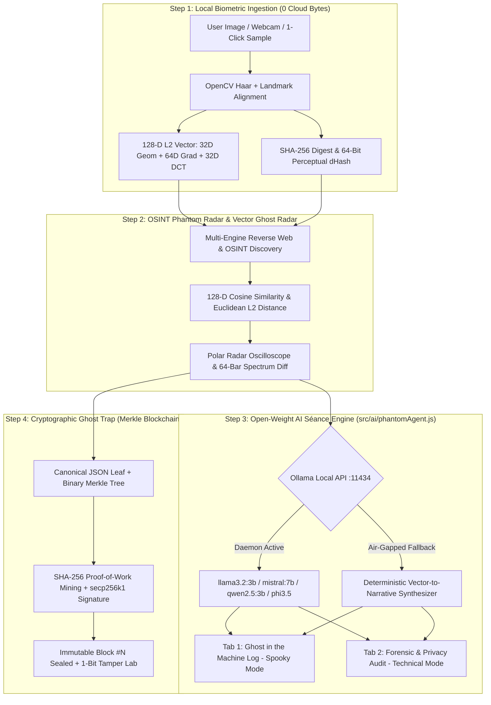

<div align="center">

# 👻 PHANTOMLEDGER
### Hunting Digital Doppelgängers in the Machine — 100% Open-Source Local Biometric Séance & Merkle Blockchain Pipeline

[](https://harinarayana1457-cmyk.github.io/HHG-3/)
[](https://ollama.com/)
[](https://www.python.org/)
[](https://fastapi.tiangolo.com/)
[](https://reactjs.org/)
[](https://opencv.org/)
[](https://opensource.org/licenses/MIT)

<p align="center">
  <b>PhantomLedger</b> is a local-first, cyber-occult forensic verification pipeline built for the <b>"Ghost in the Machine" Open-Source AI Challenge</b>. It extracts a human subject's <b>128-D OpenCV facial embedding</b> locally (0 bytes leaked to the cloud), hunts unauthorized <b>digital doppelgängers</b> across OSINT web indexes, channels a local open-weight LLM <b>"Séance Engine"</b> (<code>Ollama</code> + zero-dependency offline fallback), and traps detected phantoms inside a tamper-evident <b>Merkle Blockchain</b>.
</p>

[✨ Key Features](#-key-features) • [🏛️ System Architecture](#-system-architecture) • [🔮 Ollama Séance Setup](#-offline-ollama--open-weight-llm-setup) • [🚀 Quickstart](#-quickstart-guide) • [📂 Project Structure](#-project-structure) • [🧪 Automated Tests](#-automated-testing)

</div>

---

## 🌟 Key Features

### 1. 🧬 Local Biometric Capture (`OpenCV` 128-D Embeddings — 0 Cloud Bytes Leaked)
* Detects facial bounding boxes and craniofacial landmarks (eyes, nose bridge, mouth corners, jawline) locally on your machine.
* Extracts a **128-dimensional L2-normalized biometric vector**:
  * **Dims `00..31`:** Craniofacial geometric landmark ratios
  * **Dims `32..95`:** 4×4 spatial gradient & structural density histograms
  * **Dims `96..127`:** 2D-DCT spectral frequency coefficients (sensitive to GAN/deepfake upscaling artifacts)
* Computes raw image **SHA-256 cryptographic digests** and **64-bit Perceptual Hashes (`dHash`)**.

### 2. 📡 OSINT Phantom Radar & 128-D Vector Ghost Radar
* Sweeps web and social media OSINT indexes to discover unauthorized reposts, synthetic clones, and dead-internet impersonator bots.
* Computes exact **Cosine Similarity** and **L2 Euclidean Distance (`||u - v||₂`)** between the **Living Original (`#00FF9C`)** and the **Detected Web Phantom (`#FF4D4D`)**.
* Visualizes the comparison on a **16-sector Polar Radar Oscilloscope** and a **64-channel Interactive Spectrum Overlay**.

### 3. 🔮 Open-Weight AI "Séance Engine" (`src/ai/phantomAgent.js`)
* Connects to local **Ollama** (`http://localhost:11434/api/generate`) with dynamic hot-swapping across open-weight models:
  * `llama3.2:3b` (Meta Llama 3.2 3B — *Spectral OSINT Whisperer*)
  * `mistral:7b` (Mistral 7B v0.3 — *Deep Cryptographic Inquisitor*)
  * `qwen2.5:3b` (Qwen 2.5 3B — *128-D Vector Anomaly Analyst*)
  * `phi3.5` (Microsoft Phi-3.5 Mini — *Air-Gapped Forensic Sentinel*)
* Includes a live **System Prompt Editor** with one-click persona presets (*"Paranormal Terminal Possessor"*, *"Strict Cryptographic Forensic Auditor"*, *"Dead-Internet Counter-Insurgency Unit"*).
* Features an automatic **Zero-Dependency Offline Fallback**: if Ollama is not running on a judge's machine, the Séance Engine deterministically synthesizes both reports directly from the 128-D vector distances and OSINT telemetry without errors.
* Outputs **two structured tabs** for every scan:
  1. **👻 "Ghost in the Machine Log" (Spooky Mode):** Eerie terminal narration describing where the user's digital doppelgänger was spotted while they were asleep (`03:14 UTC`), the exact 128-D Euclidean/cosine similarity score, and how the phantom was trapped in Block `#N`.
  2. **🛡️ "Forensic & Privacy Audit" (Technical Mode):** Mathematical breakdown of 128-D sub-vector drift, anomaly flags, zero-byte cloud telemetry attestation, and Merkle root proof.

### 4. ⛓️ Cryptographic "Ghost Trap" (Custom Merkle Blockchain + Solidity Contract)
* Seals the human identity digest and detected doppelgänger evidence inside a **Binary Merkle Tree**, mined via **SHA-256 Proof-of-Work (`0x00...`)** and signed by an **ECDSA `secp256k1` validator authority**.
* Includes an interactive **Tamper Simulation Lab** that proves altering even 1 byte of a URL, author handle, or image hash immediately invalidates the Merkle root audit path.

### 5. 🖥️ "Haunted Forensic Terminal" UI & Live Sovereignty HUD
* Dark **Cyber-Occult / Haunted Terminal** aesthetic (`#090A0F` obsidian background, `#00FF9C` phosphor green, `#FF4D4D` blood-orange alerts, `JetBrains Mono` typography).
* **"Why Open Innovation Matters" Live Sovereignty HUD** displaying local inference status, `0 B` cloud leak counter, open-weight model selector, and live Merkle block height.
* **Haunted Shell Commentary Bar** that whispers real-time eerie telemetry on every action.

---

## 🏛️ System Architecture

The following diagram illustrates the end-to-end evidence pipeline—from image ingestion and biometric feature extraction through reverse search discovery, blockchain anchoring, and tamper-evident verification:



---

## 🔮 Offline Ollama & Open-Weight LLM Setup

**PhantomLedger works immediately out-of-the-box even if Ollama is not installed** thanks to its built-in Zero-Dependency Deterministic Séance Engine.

To enable live open-weight LLM inference via **Ollama**:

```bash
# 1. Install Ollama from https://ollama.com and start the local server
ollama serve

# 2. Pull any of the supported open-weight models:
ollama pull llama3.2:3b
ollama pull mistral:7b
ollama pull qwen2.5:3b
ollama pull phi3.5
```

Once running on `http://localhost:11434`, the Sovereignty HUD automatically switches its badge to **`🟢 OLLAMA DAEMON (:11434)`** and lets you hot-swap models or customize the system prompt live.

---

## 🚀 Quickstart Guide

### Prerequisites
* **Python 3.10+**
* **Node.js v18+** & **npm**

### 1. Install Python Dependencies
```bash
pip install -r requirements.txt
```

### 2. Build the Haunted Forensic Terminal Frontend
```bash
cd frontend
npm install
npm run build
cd ..
```

### 3. Launch PhantomLedger
```bash
python run.py
```
* **Main Haunted Forensic Terminal:** [http://localhost:8000](http://localhost:8000)
* **Interactive API Documentation (Swagger UI):** [http://localhost:8000/docs](http://localhost:8000/docs)

---

## 📂 Project Structure

```text
HHG-3/
├── backend/
│   ├── face_engine.py               # OpenCV face detection, landmarks, 128-D embeddings, SHA-256, dHash
│   ├── search_engine.py             # OSINT Phantom Radar, 128-D Euclidean/cosine scorer & fallback index
│   ├── blockchain_engine.py         # Binary Merkle trees, ECDSA secp256k1 authority, PoW mining, ledger
│   └── main.py                      # FastAPI REST API & static web server
├── src/
│   └── ai/
│       └── phantomAgent.js          # Root mirror of the Open-Weight AI Séance Engine
├── frontend/
│   ├── src/
│   │   ├── ai/
│   │   │   └── phantomAgent.js      # Ollama client (:11434), System Prompt presets & Offline Séance Engine
│   │   ├── components/
│   │   │   ├── VectorGhostRadar.jsx # 128-D Polar Radar Oscilloscope & 64-Channel Spectrum Comparator
│   │   │   ├── SeanceEnginePanel.jsx# Spooky Log + Forensic Audit tabs & System Prompt Editor
│   │   │   ├── BlockchainExplorer.jsx# Live Merkle block visualizer & transaction search
│   │   │   └── VerificationLab.jsx  # Interactive 1-bit cryptographic tamper simulator
│   │   ├── App.jsx                  # Haunted Forensic Terminal, Sovereignty HUD & Haunted Shell Bar
│   │   └── index.css                # Cyber-Occult phosphor/obsidian styles
│   └── package.json
├── contracts/
│   ├── FaceEvidenceRegistry.sol     # Solidity smart contract for EVM chains
│   └── deploy.py                    # Web3.py deployment script
├── tests/                           # End-to-end automated test suite
├── SUBMISSION_POST.md               # "Ghost in the Machine" Challenge Submission Post
├── run.py                           # Single-command full-stack launcher
└── requirements.txt
```

---

## 🧪 Automated Testing

Run the complete unit and end-to-end integration test suite:

```bash
python -m tests.test_face_engine
python -m tests.test_blockchain
python -m tests.test_search_engine
python -m tests.test_api
```

---

## 📜 License

Distributed under the **MIT License**. See [`LICENSE`](LICENSE) for full details.

---

## 🔗 Connect & Author

**Harinarayana Avvari**

[](https://www.linkedin.com/in/hari-narayana-035ba1389/)
[](https://github.com/harinarayana1457-cmyk)

<div align="center">
  <sub>Engineered for media authenticity, open-source intelligence (OSINT), and tamper-evident cryptographic digital forensics.</sub>
</div>
