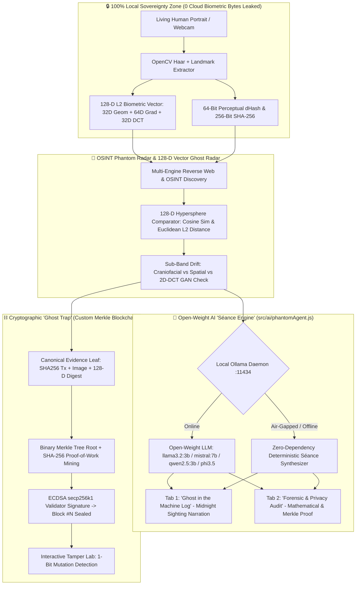

# 👻 PhantomLedger — Hunting Digital Doppelgängers in the Machine

> **Submission for the "Ghost in the Machine" Open-Source AI Challenge**  
> *100% Open-Source · Local 128-D Biometric Capture · OSINT Phantom Radar · Local Ollama "Séance Engine" · Cryptographic Merkle Ghost Trap*

---

## 🕯️ The Problem: Your Face Is Haunting the Machine While You Sleep

Across the modern web, scraped portraits, unauthorized AI face-swaps, and dead-internet impersonator bots spawn **digital doppelgängers** ("ghosts") of real human beings. While you are asleep at `03:14 UTC`, an autonomous bot or synthetic media account could be wearing your face across social feeds.

Worse yet, closed-source cloud "identity protection" APIs demand a Faustian bargain: **to check if your face was stolen, you have to upload your raw biometric portrait to another third-party cloud server.**

**PhantomLedger (`HHG-3`)** breaks that cycle using **100% open-source, local-first AI and cryptographic sovereignty**:

1. **🧬 Local Biometric Capture (`OpenCV` 128-D Embeddings):** Extracts a 128-dimensional L2-normalized craniofacial embedding vector (`32-D landmark geometry`, `64-D spatial gradients`, `32-D 2D-DCT spectral frequencies`), a 64-bit Perceptual `dHash`, and a `SHA-256` digest entirely on your machine. **0 bytes of raw biometric data ever leave your device.**
2. **📡 OSINT Phantom Radar & 128-D Vector Ghost Radar:** Sweeps target web and social OSINT indexes to flag unauthorized digital doppelgängers, computing exact **Cosine Similarity** and **L2 Euclidean Distance (`||u - v||₂`)** across the 128-D hypersphere and highlighting high-frequency 2D-DCT GAN/deepfake anomalies.
3. **🔮 Open-Weight AI "Séance Engine" (`Ollama` + Zero-Dependency Air-Gapped Fallback):** Connects to a local open-weight LLM (`llama3.2:3b`, `mistral:7b`, `qwen2.5:3b`, or `phi3.5` via `http://localhost:11434/api/generate`) with a live **System Prompt Editor**. For every scan, the Séance Engine outputs two structured tabs:
   - **👻 Tab 1: "Ghost in the Machine Log" (Spooky Mode):** An eerie terminal narration detailing where your digital doppelgänger was spotted while you slept, citing exact 128-D Euclidean/cosine distances and how the phantom was sealed in Block `#N`.
   - **🛡️ Tab 2: "Forensic & Privacy Audit" (Technical Mode):** A mathematical breakdown of sub-vector drift, synthetic artifact flags, zero-byte cloud egress attestation, and Merkle root verification.
4. **⛓️ Cryptographic "Ghost Trap" (Custom Merkle Blockchain):** Commits your authentic human biometric digest and the detected doppelgänger forensics into a binary **Merkle Tree** backed by **SHA-256 Proof-of-Work mining** and **ECDSA (`secp256k1`) validator signatures**—proving who the real human is in a tamper-evident ledger no cloud vendor can alter or shut down.

---

## 🏛️ System Architecture



---

## 🖥️ Inside the "Haunted Forensic Terminal"

We refactored the entire interface into a high-contrast **Cyber-Occult / Haunted Forensic Terminal** (`#090A0F` obsidian background, `#00FF9C` spectral phosphor green, `#FF4D4D` blood-orange doppelgänger alerts, and `JetBrains Mono` typography):

### 1. "Why Open Innovation Matters" Live Sovereignty HUD
Pinned to the top of the terminal, the Sovereignty HUD gives real-time cryptographic and privacy telemetry:
- **`LOCAL INFERENCE: ACTIVE (Air-Gapped Ready)`** — Indicates whether local Ollama (`:11434`) or the built-in Zero-Dependency Offline Séance Engine is active.
- **`CLOUD BYTES LEAKED: 0 B (On-Device)`** — Guarantees raw facial biometrics stay in local memory.
- **`OPEN MODEL SELECTOR` + `System Prompt Editor`** — Hot-swap between `llama3.2:3b`, `mistral:7b`, `qwen2.5:3b`, and `phi3.5`, and switch personas between *"Paranormal Terminal Possessor"*, *"Strict Cryptographic Forensic Auditor"*, and *"Dead-Internet Counter-Insurgency Unit"* (or write your own custom system prompt).
- **`MERKLE LEDGER STATUS`** — Live block height (`Block #N`) and current Merkle root hash.

### 2. 128-D Vector Ghost Radar (`frontend/src/components/VectorGhostRadar.jsx`)
Compares the **Living Original (`#00FF9C`)** against the **Detected Web Phantom (`#FF4D4D`)** using:
- A 16-sector polar radar oscilloscope plotting both 128-D embeddings on the L2 unit hypersphere.
- Sub-vector drift gauges across **Dims `00..31` (Craniofacial Geometry)**, **Dims `32..95` (Spatial Gradients)**, and **Dims `96..127` (2D-DCT Spectral Frequency Check)**.
- A 64-channel interactive spectrum bar chart where hovering any bar reveals the exact dimension delta (`Δ`) between the human original and the web clone.

### 3. Haunted Shell Commentary Bar
A persistent bottom terminal drawer that "possesses" the application and whispers timestamped, eerie real-time logs whenever you ingest a portrait, extract a 128-D vector, spot an OSINT doppelgänger, switch open-weight models, or trap a phantom inside a mined Merkle block.

---

## 🚀 Quickstart & Judge Evaluation Guide

PhantomLedger works **out of the box with zero cloud API keys** and includes an automatic **Zero-Dependency Offline Fallback** if Ollama is not running on the test machine.

### 1. Install & Launch
```bash
pip install -r requirements.txt
cd frontend && npm install && npm run build && cd ..
python run.py
```
Open **[http://localhost:8000](http://localhost:8000)**.

### 2. Optional: Enable Live Local Ollama Open-Weight Models
To run live local LLM inference alongside the deterministic engine:
```bash
ollama serve
ollama pull llama3.2:3b
# Optional additional open-weight models supported in the HUD dropdown:
ollama pull mistral:7b
ollama pull qwen2.5:3b
ollama pull phi3.5
```

### 3. Run Automated Verification Suite
```bash
python -m tests.test_face_engine
python -m tests.test_blockchain
python -m tests.test_search_engine
python -m tests.test_api
```

---

## 📜 License & Open-Source Commitment

Released under the **MIT License**. Built with Python, FastAPI, OpenCV, NumPy, React 18, Tailwind CSS, Ollama Open-Weight LLMs, ECDSA (`secp256k1`), and Solidity (`^0.8.20`).
